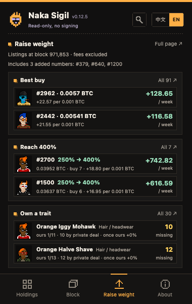
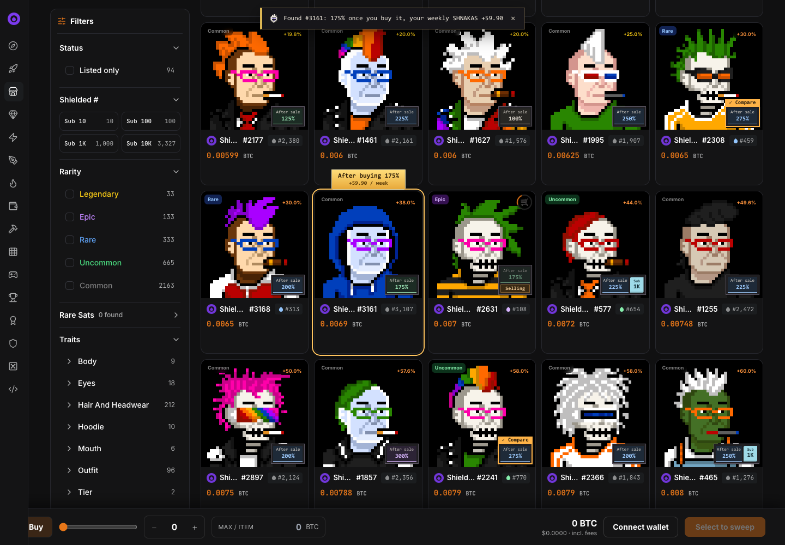
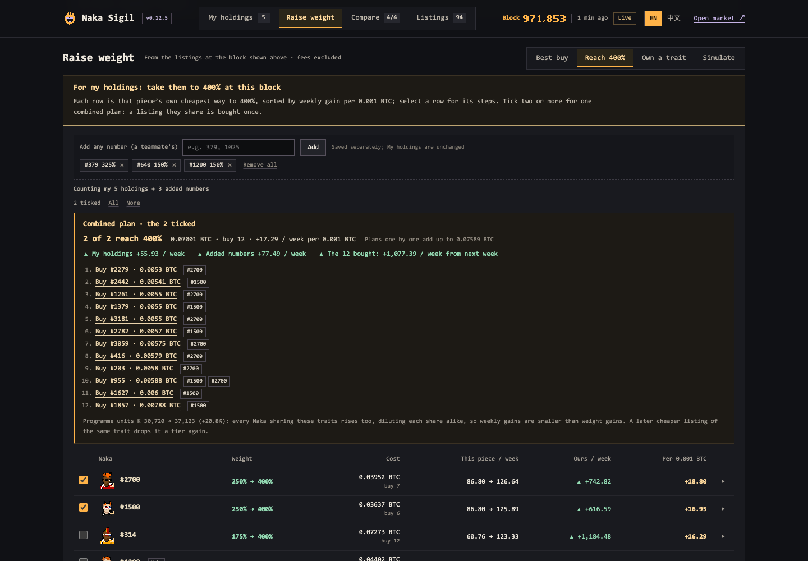

# Naka Sigil

**Find your Naka. Raise your weight.**

A read-only Chrome extension for [Shielded Nakas on Ord Dropz](https://ord-dropz.xyz/secondary/collections/shielded-nakas-mupv6wja): what your Nakas earn each week, what a purchase changes, and the cheapest way to raise your weight.

**[Join the Naka Telegram group](https://t.me/+fRT4yVcxZ6VlNTBl)** for questions, feedback and wanted posts.

<table><tr><td></td><td></td><td></td></tr></table>






## What it does

- **This week's SHNAKAS.** Accrued so far, projected for the week, what the last block paid and your share of the pool. Each Naka says whether it counts this week and why, with blocks; finished weeks and pieces you sold are listed from the official weekly tables. A sale of a holding is read from the public records and moves it to Left on its own, and the popup names that week's sales in one line until you open or dismiss it; one the records cannot attribute (a listing that was already open when you added the piece) is asked in the popup. **Copy all numbers** puts your list on the clipboard as plain numbers that anyone's Add box imports.
- **Raise weight.** The popup gives the answers in one screen: the two best listings to buy, the two pieces cheapest to take to 400% and the two traits closest to owning, one click from the market card or the full plan. The extension page does the planning. *Best buy*: the listings that add the most weekly SHNAKAS per 0.001 BTC. *Reach 400%*: one row per piece with its own cheapest plan, best value first; tick several for one combined plan, a teammate's numbers included. *Own a trait*: the traits buying listings makes yours and how long their bonus then lasts; for the others, the numbers to ask for privately, copied as a wanted post for the Naka Telegram group. *Simulate*: what a listing, sale or reclaim does to you and everyone.
- **On the market.** After-sale weight on every listing and what buying it does to your holdings; listings someone is already buying are marked. Every link to one Naka scrolls the market to its card and highlights it, so a piece sold a moment ago shows as sold instead of failing at checkout.
- **Look up and compare.** The magnifier opens Look up over any popup tab: any number at the latest block or a past one; up to four Nakas side by side.

Read-only: no wallet connection, login, approval or signature. English and 中文.

## Install

Building from source is recommended:

```sh
npm test
npm run package:chrome
```

Then open **chrome://extensions**, turn on **Developer mode**, choose **Load unpacked** and select `dist/chrome`. Node.js and the system `zip` command are needed. Or download the [ready ZIP](release/README.md), check its SHA-256 against [SHA256SUMS](release/SHA256SUMS) and load the extracted folder. The extension ID is **bcihombccpheaimcgldamaggokpgpidl**. To update, replace the folder's contents and press **Reload** (if Chrome was only restarted, the popup offers that Reload); uninstalling first deletes your saved holdings.

## How the numbers work

- **Weight** = 100% base + trait bonuses + the highest number bonus, capped at 400%, scored every block from the listings left after it. A trait's bonus comes from its floor ÷ the collection floor (1.25×, 1.5×, 2×, 3× → +25 to +100%); a trait with no listing gets +100% from 20 pieces, a smaller one its last three sales. There is no weekly or quarterly snapshot.
- **Weekly SHNAKAS** = your units × v × 1,008 ÷ 10⁸, with v = floor(26,664,000,000,000 ÷ 1,008 ÷ K) and K the units of all 3,333 pieces (100% = 4 units). This week's amount is read from the official accumulator, not estimated.
- **Who is paid.** A week pays only a holder who kept the piece the whole week without listing or sending it: a Naka bought, reclaimed or received in a week counts from the next week; the week a piece is listed, sold or sent pays nobody for it. Public listings, sales and reclaims are read from the public records; a private transfer is not public, so amounts stay a **reference** until you sync the official Wallet page. Unclaimed weeks can wait until block 1,102,740.

Every case and the evidence behind it: [rules audit](docs/RULES_AUDIT.md). Worked examples: [reproducibility](docs/REPRODUCIBILITY.md). Checks: [validation](docs/VALIDATION.md). What is stored and sent: [privacy](docs/PRIVACY.md). Screenshots use example holdings (#6, #314, #888, #1500, #2700), example added numbers (#379, #640, #1200) and public data.

## 中文说明

**找到你的 Naka，增加你的权重。** 只读的 Chrome 插件：看清每枚 Shielded Naka 每周能分到多少 SHNAKAS、买一单会带来什么变化，以及最省钱的加权重方案。

**[进入 Naka Telegram 交流群](https://t.me/+fRT4yVcxZ6VlNTBl)**：提问、反馈和求购。

- **本周 SHNAKAS**：本周累计、本周预计、最新一块分到的数量和本周占比；每一枚都写明本周有没有奖励、为什么，并给出区块号；已结束的周和卖出的 Naka 按官方周累计表列出。持仓成交后，插件从公开记录读到并自动移到“已离手”，弹窗在持仓上方用一行写明本周卖出的，点“查看”或“×”后不再提示；公开记录分不清是卖出还是买入的（加入时就已在挂单的那一单），在弹窗里直接问你。“复制全部编号”把持仓复制成纯数字清单，别人在“添加”里粘贴就能导入。
- **增加权重**：弹窗一屏直接给结论：最划算的 2 单挂单、单独冲 400% 最划算的 2 枚、最接近垄断的 2 个特征，一点就到市场上的那张卡或完整方案。完整规划在独立页。*买哪单划算*：每 0.001 BTC 换来每周增量最多的挂单。*冲 400%*：每枚一行，是它单独冲的最省钱做法，按性价比排序；勾选几枚（可加入队友编号）合起来算一份方案。*垄断特征*：买下挂单就能垄断的特征，以及垄断后加成能维持多久；其余的列出需要私下收购的编号，一键复制成求购信息，发到 Naka Telegram 群。*模拟*：挂单、成交或撤单对自己和全网的影响。
- **市场页**：每个挂单显示成交后权重和对持仓的影响；别人正在买的挂单会标出来。所有跳到某一枚的链接都会把市场页滑到那张卡片并高亮，刚被买走的直接显示已售，不会到结账时才失败。
- **查询与比较**：弹窗右上角的放大镜在任何页面都能打开查询：任意编号的最新区块或过去区块；最多四枚并排比较。

只读：不连接钱包，不需要登录、授权或签名。中英文界面。

**安装**：建议自行编译：运行 `npm test`、`npm run package:chrome`，在 **chrome://extensions** 打开开发者模式，选“加载已解压的扩展程序”，选择 `dist/chrome`。需要 Node.js 和系统 `zip` 命令。也可以下载[现成安装包](release/README.md#中文说明)，按 [SHA256SUMS](release/SHA256SUMS) 校验后加载解压目录。插件 ID 固定为 **bcihombccpheaimcgldamaggokpgpidl**；更新时替换目录内容并点“重新加载”（如果只是重启了 Chrome，弹窗会提供“重新加载插件”按钮），先卸载会删除已保存的持仓。

**数字怎么来的**：权重 = 基础 100% + 特征加成 + 最高一档编号加成，封顶 400%，按每个区块之后剩下的挂单逐块计算；特征加成按特征地板 ÷ 集合地板（1.25×、1.5×、2×、3× 对应 +25% 到 +100%），零挂单特征满 20 件 +100%，不足 20 件按最近三笔成交；没有周或季度快照。每周 SHNAKAS = 你的权重单位 × v × 1,008 ÷ 10⁸，v = floor(26,664,000,000,000 ÷ 1,008 ÷ K)，K 是全部 3,333 枚的单位合计（100% = 4 单位）；本周累计直接读官方累计表。一周的奖励只给整周持有、这一周没挂单也没转出的一方：本周买入、撤单取回或收到的从下一周起有奖励，挂单、卖出或转出的那一周这一枚谁都没有奖励。公开挂单、成交和撤单从公开记录读取；私下转账没有公开记录，所以在官方钱包页同步之前金额标为“参考”。没领的周可以攒到区块 1,102,740 前一次领。

各种情况与依据见[规则核对](docs/RULES_AUDIT.md)，复算示例见[复现文档](docs/REPRODUCIBILITY.md)，检查记录见[验证文档](docs/VALIDATION.md)，存储与网络见[隐私说明](docs/PRIVACY.md)。截图用的是示例持仓（#6、#314、#888、#1500、#2700）、示例添加编号（#379、#640、#1200）和公开数据。
