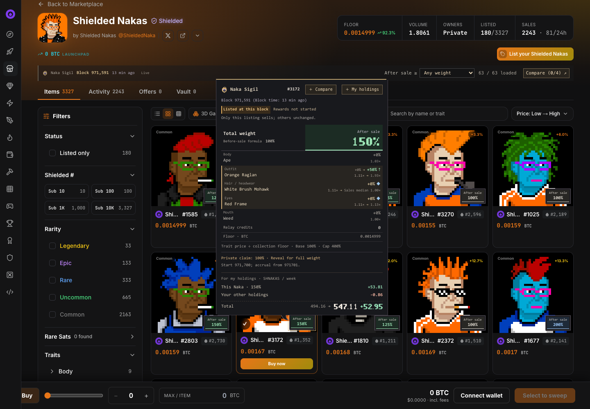
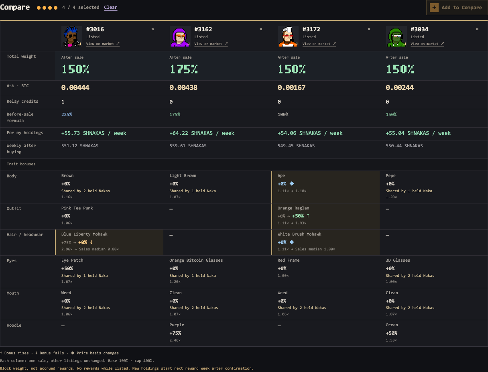
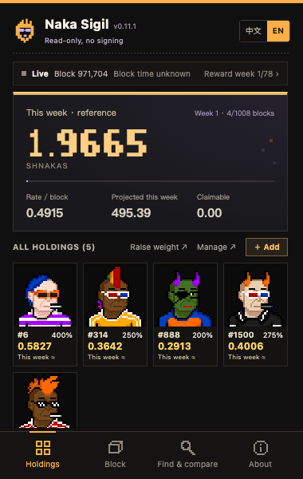
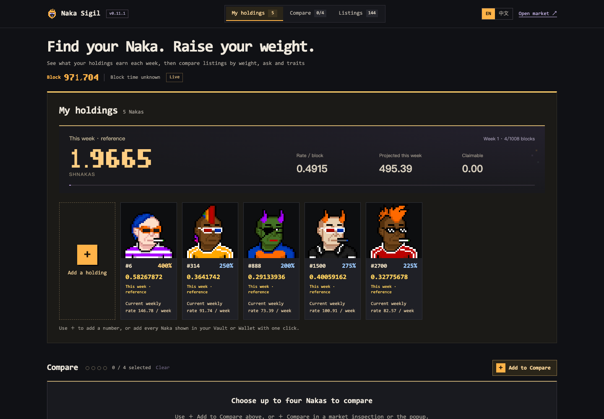
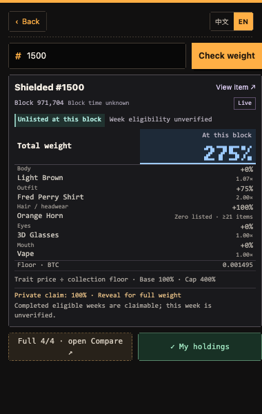

# Naka Sigil

**Find your Naka**

See what a purchase changes, directly on [Ord Dropz](https://ord-dropz.xyz/secondary/collections/shielded-nakas-mupv6wja): after-sale weight, ask price, and its impact on your holdings. Track SHNAKAS accrual in a read-only pixel workspace.

- **Holdings:** add visible Nakas from either Vault layout, or enter numbers manually across accounts. Multiple numbers accept commas or spaces.
- **Rewards:** this week's accrued amount, current per-block rate, projected week, and per-Naka detail. Figures update on confirmed blocks. The focused reward card keeps the amount prominent.
- **Compare:** up to four Nakas, asks, after-sale weights, changed bonuses and effects on your existing holdings. Enlarged artwork on hover.
- **Market:** compact listing and Activity badges, weight filters, and a filter for purchases that improve your holdings' weekly rate. Listed holdings explain the effect of delisting.
- **History:** inspect a number at a past block without changing Live holdings, comparisons or market calculations.

English by default · 中文 available · no wallet connection · no API key · no signing or transactions

## Install

**Strongly prefer building from source yourself.** If you want the ready-made option, download the current [installation ZIP](release/README.md). Check its **SHA-256** against [release/SHA256SUMS](release/SHA256SUMS), extract it, then load the extracted directory through **chrome://extensions → Developer mode → Load unpacked**.

```sh
npm test
npm run package:chrome
```

Load `dist/chrome`. Node.js and a system `zip` command are required; runtime dependencies are bundled. Keep the same installation directory when updating, click **Reload**, and refresh the market tabs. The public extension ID is **bcihombccpheaimcgldamaggokpgpidl**. User holdings, comparisons and language stay local and are retained across updates; incompatible public API caches can be refetched. Do not uninstall first: Chrome removes extension storage on uninstall.

## Data and calculations

The extension follows the latest synced block while a supported view is visible. **At block** is temporary historical inspection, with loading progress and a small worker-memory cache. It cannot change the production block. Upcoming reward-week shortcuts are disabled; they are not quarterly weight snapshots.

The official live programme measures weights **per block**: base 100% + trait bonuses + highest number bonus, capped at 400%. A purchase removes only that listing and recalculates trait and collection floors. Each holding is capped separately. Remaining public relay credits are separate from weight.

For a block with total catalogue units `K`, one 25% weight unit earns `v = floor(poolPerWeek / 1008 / K)` base units per block. The current weekly rate is `pieceUnits × v × 1008 / 10^8`. This is a rate, not a guaranteed final week total. Completed-block accrual uses the official `/rewards/weights/{weekIndex}` accumulated vector, so changing rates are integrated rather than multiplying today's rate by elapsed blocks. The packed vector is about 35.6 KB and is cached locally; no per-block historical snapshot download is needed.

A number alone does not establish personal eligibility, historic ownership or paid claims. Until you explicitly sync visible earning states from the official Vault staking screen, accrual is labelled **reference**, assuming held and unlisted since the week began. The import reads shown identities and earning states only, without wallet secrets or private storage. Eligibility is tracked for that week; resync after transfers. Unknown personal claimable amounts remain unknown. In week one, claimable is zero until the first week finishes. Claimed wallet balances cannot be reconstructed from the public weights API.

Programme anchor: **971700**. First rewarded block: **971701**. A reward week is **1008 blocks**, for **78 weeks**; first claim boundary **972709**. Listing pauses accrual; delisting/new ownership starts earning in the next eligible reward week. Previously completed holding-week claims do not transfer with the NFT. Current data does not establish a frozen first-quarter weight.

Same-block official fallback values, including `lastBlock`, are validated against block, floor and per-piece totals. Unsupported sources fail validation. After-sale scenarios retain a range where public inputs cannot determine one value. The standalone [demo](demo/index.html) remains historical and needs no extension; its example holdings do not represent a user's wallet.

## Screenshots

The reward and workspace screenshots use synthetic example holdings with public block data, not a personal wallet or a claimable balance. The market image is a historical public-data example; these are not current quotes.







[Reward-rule audit](docs/RULES_AUDIT.md) · [Privacy](docs/PRIVACY.md) · [Validation](docs/VALIDATION.md) · [Reproducibility](docs/REPRODUCIBILITY.md)

## 中文说明

**找到你的 Naka**：在交易市场直接查看成交后权重、挂价及对原有持仓的影响，并在只读像素界面跟踪 SHNAKAS 累计。

- **持仓与奖励**：保险库一键加入当前显示的 Naka，或输入其他账号的编号；多个编号支持英文逗号、空格分隔。本周累计为主，当前每块速率、本周预计及每枚明细为辅。
- **比较与市场**：最多四枚，比较挂价、成交后权重、属性变化和持仓影响；支持大图预览、Activity 权重、挂单筛选及撤单影响。
- **历史查询**：只查看本次过去区块，不改变实时持仓、比较或市场数据；加载有进度提示，未来奖励周起点不可选择，它们不是季度权重快照。

**强烈建议自行编译安装。** 想直接使用，可下载[现成安装包](release/README.md)，按 [release/SHA256SUMS](release/SHA256SUMS) 验证 **SHA-256**，解压后从 **chrome://extensions → 开发者模式 → 加载已解压的扩展程序** 安装。自行构建使用上方相同的 `npm test`、`npm run package:chrome` 命令，然后加载 `dist/chrome`。需要 Node.js 和系统 `zip` 命令。

更新时覆盖原加载目录、重新加载扩展并刷新网页。公开版 ID 固定为 **bcihombccpheaimcgldamaggokpgpidl**，持仓、比较和语言清单保留；只有不兼容的公开 API 缓存会重新获取。暂时未出现在缓存中的 NFT 编号不会删除。不要先卸载扩展，Chrome 会在卸载时删除其存储。无需连接钱包、API key、登录、签名或交易。

权重按**每个区块**的地板价计算：基础100%＋特征加成＋最高编号加成，上限400%。购买情景仅移除该挂单、重算特征和集合地板，每枚持仓分别封顶。中继额度与权重分开显示。

设全目录权重单位合计为 `K`，每个25%权重单位每块得到 `v = floor(每周奖池 / 1008 / K)` 个最小单位；当前每周速率为 `藏品单位数 × v × 1008 / 10^8`，并非本周最终承诺。本周累计直接读取官方 `/rewards/weights/{weekIndex}` 累计向量，包含每块速率变化，不能用当前速率乘已经过的区块。向量压缩后约35.6 KB，本机缓存、随确认块更新，不需要逐块拉取历史快照。

仅有编号不能证明个人资格、历史持有和已领取情况。在官方保险库质押页面主动同步已显示的计奖资格前，金额标为**参考**，假设本周开始前持有且未挂单。同步只读已显示的藏品身份和计奖状态，不读取钱包秘密或私人存储；转移后请重新同步。无法核实的个人可领取保持未知，第一周结束前为零。公开权重 API 无法还原已领取的钱包余额。

启动锚点 **971700**，首个计奖块 **971701**，每周 **1008块**，共 **78周**，首次领取边界 **972709**。挂单暂停计奖；撤单或新持有记录从下个符合条件的奖励周开始。此前完整持有周的领取权不随 NFT 转移。奖励启动和出现累计金额不代表第一季度权重已冻结。

同区块官方依据（包括 `lastBlock`）保留高度、地板价及逐枚校验；未知类型继续拒绝。公开输入不足的成交情景保留范围。免安装[演示页](demo/index.html)继续使用历史数据，示例持仓不代表用户的钱包。奖励、工作台截图使用合成示例持仓和公开区块数据，不是个人钱包或可领取余额；市场截图为历史公开数据，均非实时报价。
